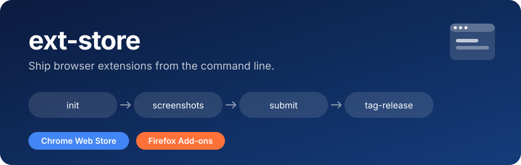

<p align="center">
  
</p>

Requires [Bun](https://bun.sh/).

- **Set up** a repo: `init`
- **Check** what's live and in review: `status`
- **Submit** to both stores, with checks first: `submit`
- **Tag** a GitHub release from `CHANGELOG.md`: `tag-release`
- **Screenshots** captured from the real extension and framed: `screenshots`
- **Replace** the Firefox listing's screenshots: `screenshots upload`

```sh
ext-store init | status | submit | auth | tag-release
ext-store screenshots [setup|upload] [--only <id>]
```

`--dry-run` changes nothing. `--yes` skips prompts.

## Get started

- `bun add -d @ajgeel/ext-store web-ext`
- `bunx ext-store init`
- Fill in `.env` ([credentials](docs/credentials.md))
- `bun run store:auth`, then `bun run store:status`

Your build provides `dist/chromium(.zip)` and `dist/firefox(.zip)` (via `bun run ship`), and a `CHANGELOG.md` with `## [V<version>]` sections.

## Release

- Bump `version`, add a changelog section, merge.
- `bun run store:submit`
- `bun run tag-release`

## Screenshots

Needs `bun add -d playwright` and an MV3 extension.

```ts
import { defineConfig } from "@ajgeel/ext-store";
import { waitForImages } from "@ajgeel/ext-store/screenshots";

export default defineConfig({
  name: "My Extension",
  screenshots: {
    now: new Date("2026-06-20T16:20:00+02:00"),
    prepare: async ({ context, worker }) => {}, // mock routes, seed storage
    ready: async (page) => {}, // wait for the UI
    scenes: [
      { id: "hero", headline: ["First line", "accent line."] },
      {
        id: "settings",
        headline: "Make it yours.",
        backdrop: "https://example.com/photo.jpg",
        prepare: async ({ worker }) => {}, // per scene
        setup: async (page, stage) => {
          await stage("opening settings", () => page.keyboard.press("s"));
          await stage("loading images", () => waitForImages(page));
        },
      },
    ],
  },
});
```

- `ext-store screenshots` writes `docs/store-listing/screenshots/1.jpg`, `2.jpg`, ...
- Also configurable: `extensionDir`, `page`, `setup`, `viewport`, `locale`, `timezoneId`, `geolocation`, `outputDir`, `frame`. See [`src/config.ts`](src/config.ts).

## Config

```ts
defineConfig({
  name: "My Extension",
  // buildCommand: ["bun", "run", "ship"],
  // releaseBranch: "main",
  // checkBuild: ({ store, dir }) => {}, // throw to stop a submission
});
```

## License

[MIT](LICENSE)

Banner: Chrome Web Store and Firefox are trademarks of Google and Mozilla. Font: [Jersey 25](https://fonts.google.com/specimen/Jersey+25) (OFL).
